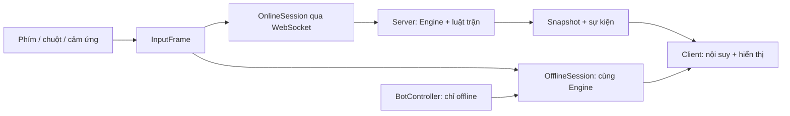

# Kế hoạch tách Legacy và chuyển thành game online có offline

**Cập nhật P2P:** Online hiện dùng WebRTC; hai máy đo hiệu năng trước mỗi trận, máy có tick ổn định hơn chạy mô phỏng trong Web Worker. Node chỉ ghép phòng và trao đổi SDP/ICE. Thiết kế máy chủ mô phỏng dưới đây là kế hoạch ban đầu, đã được thay bằng yêu cầu P2P. Xem [báo cáo hiện tại](TRIEN_KHAI.md).

**Cập nhật trước P2P:** đã có bản chạy cho engine chung, điều khiển trực tiếp, offline/PWA, phòng online 1v1 và roster 40 tướng. Xem [báo cáo triển khai](TRIEN_KHAI.md) và [hướng dẫn chạy](../README.md). Các bảng phân tích bên dưới giữ bối cảnh và tiêu chí thiết kế ban đầu; giai đoạn beta, xếp hạng và 3v3 vẫn chưa triển khai.

## Mục tiêu và trạng thái

Mục tiêu sản phẩm: Legacy trở thành game đấu trường đối kháng do **người chơi trực tiếp điều khiển đấu sĩ**. Online: mỗi vị trí đấu sĩ là một người thật, không tự thêm bot khi thiếu người. Offline: người chơi điều khiển đấu sĩ, đối thủ do bot điều khiển. Các vật triệu hồi/ụ súng vẫn được vận hành bằng luật kỹ năng; chúng không phải vị trí người chơi.

Ưu tiên bản đầu **1v1 trong phòng riêng**, sau đó ghép trận và 3v3. Giữ bản sắc Legacy: điểm văng %, lực đẩy, mép sàn, stock, A/B/C/D/Nộ và sàn có chướng ngại. Không biến Legacy thành đấu trường bo/nhà cái của Battleground.

Hiện đã tách ranh giới phát triển/build: `legacy/package.json`, bộ công cụ riêng, tài liệu riêng và gói `dist/` tự chứa code/media. Nguồn Legacy vẫn trong cùng Git repo; kho media đầu vào vẫn dùng chung khi build. Chưa tạo repository bên ngoài. Trang chính hiện là game điều khiển trực tiếp, offline đấu bot hoặc online 1v1. Bản HLV/AI cũ giữ riêng tại `coach.html`.

## Những gì phải thay đổi theo mã hiện tại

| Vị trí trước khi tách | Hành vi ban đầu | Hướng thay đổi |
| --- | --- | --- |
| `js/09-main.js` — `frame()` | `requestAnimationFrame` cấp dt biến thiên cho mô phỏng; phím số ra lệnh HLV, Space tạm dừng | Tách render và fixed tick; đưa input người chơi vào controller. Online không cho một người pause/tăng tốc cả trận. |
| `js/06-match.js` — `spawnSide()`, `update()` | Luôn tạo `new Brain`; mỗi tick cho mọi đấu sĩ gọi `brain.update()`; có AI HLV | Chọn controller theo slot. Online không tạo Brain cho đấu sĩ người thật; offline mới thêm BotController. |
| `js/04-fighter.js` — `tryUse()`, `canUse()`, `moveDir` | Đã có kiểm tra chiêu và hướng di chuyển, nhưng logic phụ thuộc target/Brain ở nhiều chỗ | Giữ lõi kiểm tra, đổi mục tiêu và hướng ngắm thành dữ liệu input rõ ràng; bỏ phụ thuộc Brain khỏi cơ chế trúng đòn. |
| `js/06-match.js`, `04-fighter.js` | Logic, draw/HUD và âm thanh ở cùng class; callback kỹ năng giữ tham chiếu object; `later(t, fn)` dùng closure | Tách engine không DOM/Canvas/Audio; event có dữ liệu; entity ID; lịch sự kiện có thể snapshot. Không chỉ thêm WebSocket quanh object Match hiện tại. |
| `js/01-core.js`, renderer | Gameplay và hiệu ứng dùng `Math.random()` chung | RNG có seed riêng cho gameplay; RNG hiệu ứng không ảnh hưởng trận. Máy chủ quyết định kết quả, không yêu cầu mọi trình duyệt tự tính giống nhau. |
| `js/03c-roster.js` — `storyProtected()` và logic quan hệ | Một số nhân vật không đánh người thân theo cốt truyện | Online bỏ miễn nhiễm theo cốt truyện; chỉ dùng team/friendly-fire của mode. Giữ quan hệ ở chế độ HLV offline tương thích nếu cần. |
| `js/07-career.js` | Tiền, trang bị, tiến trình trong localStorage `ai_battle_coach_v3` | Save offline tách schema/mode; không nhập vàng, đồ, chỉ số hoặc kết quả do client lưu vào online. Giữ save cũ và đường chuyển đổi có kiểm tra. |

## Kiến trúc đích

Sơ đồ kiến trúc được dùng cho bản đầu:



Ranh giới thư mục đích, di chuyển từng phần có kiểm tra hồi quy:

```text
legacy/
  client/       # UI, input, render, audio, dự đoán chuyển động
  engine/       # state, physics, skills, RNG, fixed tick; không DOM/mạng
  content/      # roster, arena, bộ chiêu/talent định nghĩa rõ
  controllers/  # HumanController và BotController cho offline
  protocol/     # schema input/snapshot, version và validation
  server/       # room, session, authoritative match, reconnect
  offline/      # LocalSession, save và cache PWA
  tests/        # engine, protocol, hai client, mất kết nối, offline
  tools/
```

Không tạo sẵn các thư mục rỗng như thể tính năng đã xong. Bước hiện tại giữ nguồn cũ để baseline còn chạy; từng đợt chuyển module mới phải chỉ rõ phần đã thay và kiểm tra đi kèm.

Máy chủ Node.js, transport WebSocket, triển khai một khu vực trước. Chọn thư viện transport khi triển khai server; ghim phiên bản và lockfile ở bước đó. Bản đầu dùng phòng guest có mã, token phiên ngắn hạn do server cấp, chưa cần tài khoản hoặc DB. Reconnect lưu trong RAM với thời hạn rõ ràng; lưu tài khoản/kết quả/xếp hạng trên DB ở đợt ghép trận. Không thêm dịch vụ cloud hoặc credentials trước khi có nhu cầu chạy thực tế.

## Điều khiển của người chơi

- Mỗi người sở hữu đúng một fighter slot. PC: WASD di chuyển, chuột ngắm; Q/E/R/F tương ứng A/B/C/D, Space dùng Nộ. Phép bổ trợ có ô/phím riêng nếu mode cho phép; pause offline dùng Escape. Hiển thị lại ký hiệu chiêu để không nhầm R là U.
- Điện thoại: cần ảo trái, cụm A/B/C/D/Nộ bên phải, kéo hướng và nhả để tung, nút hủy khi ngắm. Mọi input chuyển qua cùng hợp đồng với bàn phím.
- Đánh, né, phản đòn, nạp đạn, đổi dạng, chọn mục tiêu và dùng Nộ do người chơi quyết định. Nếu cần hỗ trợ ngắm trên cảm ứng phải có quy tắc rõ; không tự dùng chiêu hoặc tự đổi target chiến thuật bằng Brain.
- Quy định giữ/nhả, charge, recast, lệnh một lần và lệnh liên tục cho từng chiêu. Target hỗ trợ/đổi chỗ phải chọn rõ và xác thực từ server.
- Bản 3v3 online cần sáu người thật. Chế độ Xa Luân nếu giữ phải định nghĩa số người và quyền điều khiển khi đổi đấu sĩ; chưa đưa vào MVP 1v1. Không mặc định cho một người điều khiển cả đội AI online.

## Giao thức và luật máy chủ

Thiết kế khởi điểm: engine fixed tick **60 Hz**, snapshot khoảng **20 Hz**; mục tiêu cần đo dưới tải trước khi chốt. Render theo màn hình. Client chỉ dự đoán chuyển động của mình, nội suy đối thủ; hit, cooldown, tài nguyên, KO và kết quả là quyết định server.

`InputFrame` gồm version, matchId, seq, clientTick, hướng di chuyển chuẩn hóa, hướng ngắm, nút giữ/nhấn/nhả, actionId và targetId nếu cần. Không nhận vị trí, damage, % hoặc kết quả trận từ client. Server gán tick thực thi, xác minh quyền sở hữu slot, giới hạn tần suất/độ lớn, bỏ lệnh trùng và lệnh ngoài cửa sổ cho phép. Góc/float phải hữu hạn; target phải tồn tại và hợp lệ với kỹ năng.

`Snapshot` gồm serverTick, lastProcessedSeq của từng người, mode/contentVersion, ID và trạng thái entity, vận tốc, hướng, %, stock, cooldown, tài nguyên và sự kiện có ID chống phát lặp. Giữ byte budget; tránh gửi toàn bộ Match/Brain hoặc callback. Đạn, ảo ảnh, dây móc và owner dùng ID thay tham chiếu vòng.

- Máy chủ tự kiểm tra tầm, cooldown, tài nguyên, stun, vị trí neo, team và stock bằng các luật chung của engine. Client dự đoán sai phải sửa theo snapshot.
- Di chuyển dùng prediction/reconciliation; VFX không sinh thêm damage khi render hoặc phát lại sự kiện. Charge/timer chạy theo tick engine.
- Với Caelus, lịch sử tua ngược là trạng thái kỹ năng do server quản lý; không dùng cơ chế reconnect hoặc rewind toàn trận để giả lập.
- Version nội dung/protocol không khớp thì từ chối vào cùng phòng với thông báo cập nhật rõ ràng.

## Phòng đấu, mất kết nối và cạnh tranh công bằng

Luồng bản đầu: tạo/join phòng → chọn tướng → ready cả hai → server tạo match → đếm ngược → đấu → server chốt kết quả → đấu lại/rời phòng. Thiếu người thì chờ hoặc hủy; không thêm bot.

Mất kết nối: server tiếp tục theo thời gian trận; ngừng chuyển động/nút giữ của slot sau thời hạn input ngắn, không chuyển sang AI. Cho reconnect dự kiến 20 giây bằng token và snapshot đầy đủ; hết hạn xử thua theo luật mode. Giá trị này là đề xuất để thử nghiệm. Đóng tab/refresh không tạo thêm slot; gửi lại input không nhân đôi chiêu. Server restart trong MVP hủy trận có thông báo; chưa hứa khôi phục trận khi chưa có persistence.

Online dùng cấp, thông số và loadout chuẩn theo ruleset, không dùng độ giàu save HLV. Khóa/sửa tài năng có tương tác quá phức tạp trong giai đoạn thử có danh sách rõ; không tuyên bố hỗ trợ đủ 26 tướng nếu một số chưa dùng được bằng điều khiển thật. Các luật không tấn công người thân, AI tự nhường và nhận diện ảo ảnh dựa trên trí thông minh bot không áp lên người thật.

Triển khai web dùng HTTPS/WSS cùng origin/reverse proxy, validate Origin và session, giới hạn packet, nhịp input và số phòng. Máy chủ giữ log trận theo ID/seed/version để tái hiện lỗi; không log token. Health check, dọn phòng bỏ trống và ngắt deploy có thời gian chờ là yêu cầu vận hành, làm trước beta công khai.

## Offline phải là một chế độ hoàn chỉnh

OfflineSession dùng cùng engine, bộ chiêu và validation với server; khác nguồn input và nơi giữ state. Người chơi vẫn điều khiển thật, BotController chỉ cung cấp input cho đối thủ offline. Chế độ HLV cũ có thể giữ dưới nhãn riêng; không gọi đó là chế độ điều khiển mới.

PWA có manifest/service worker và tên cache riêng Legacy; không dùng `sw.js`/cache Battleground. Tải trước shell, roster và ảnh cần thiết; audio khoảng 110 MiB nên cho lựa chọn tải gói âm thanh kèm dung lượng, hoặc chế độ không nhạc vẫn chơi được. Sau khi tải xong phải mở mới/reload khi thiết bị không có mạng và vào trận được; chỉ build một trang tĩnh không chứng minh điều này.

Save offline lưu cục bộ có schemaVersion, version nội dung và export/import. Backup trước migrate; không xóa `ai_battle_coach_v3` cũ để ép chuyển đổi. Nếu đổi origin/domain khi tách game, localStorage không tự đi theo; cung cấp xuất/nhập thủ công. Khi trở lại online chỉ đưa tùy chọn hình/âm thanh vào, không nhập stats hoặc kết quả offline vào cạnh tranh.

## Thứ tự triển khai và điều kiện qua cổng

| Giai đoạn | Công việc | Điều kiện hoàn thành |
| --- | --- | --- |
| **0 — đã thực hiện bước cấu trúc** | Package, README, build/test và audit riêng; gói runtime tự chứa; giữ URL Legacy cũ | Build lặp lại ổn; chạy bằng server chỉ phục vụ gói xuất; không request tài nguyên ở thư mục cha hoặc mã Battleground. Chưa phải engine độc lập khỏi browser. |
| **1 — điều khiển và engine** | HumanController; bỏ Brain khỏi slot người; event/RNG/tick rõ ràng; tách DOM/render khỏi mô phỏng. Thử Valerius và Zero làm lát cắt cận/viễn chiến | Input thật làm nhân vật di chuyển/dùng chiêu; không input thì không tự đánh; engine chạy headless; cùng seed/input tái hiện state trong cùng runtime. |
| **2 — offline điều khiển thật** | LocalSession, bot dùng InputFrame, menu chọn mode, save tương thích; sau đó cache/PWA | Người đấu bot trên PC/cảm ứng; ngắt mạng/reload vẫn vào trận khi đã tải; save cũ được giữ và khả năng không audio hoạt động. |
| **3 — online 1v1 phòng riêng** | Server authoritative, guest room, ownership, input/snapshot, reconnect và luật kết thúc | Hai trình duyệt/máy khác nhau điều khiển hai tướng; client giả stats không ảnh hưởng; không bot online; thử disconnect/reconnect và kết quả duy nhất. |
| **4 — đưa đủ 26 tướng hiện có vào điều khiển mới** | Bỏ target/Brain bắt buộc, rà chiêu hold/recast/triệu hồi, story protection và talent | Ma trận 26 tướng chạy offline và online; AI chỉ ở offline; chưa hỗ trợ thì khóa có nhãn trong bản thử. |
| **5 — bổ sung 14 tướng** | Bốn đợt 4 + 4 + 3 + 3 theo [bảng chuyển tướng](DOI_CHIEU_TUONG.md) | Roster 40 tướng, mỗi đợt có kiểm tra kỹ năng/đồng bộ/hiệu năng, cân bằng theo Legacy. |
| **6 — beta và mở rộng** | Tài khoản, matchmaking, lưu kết quả, 3v3 đủ người, theo dõi vận hành và triển khai | Tải nhiều phòng; sáu client người thật; mạng chậm vẫn có hành vi xác định; quy trình deploy/rollback và dọn session đã thử. |

Không ước lượng ngày hoàn tất khi chưa đo giai đoạn 1–3. Độ khó lớn là tách mô phỏng đang gắn renderer/Brain và hỗ trợ trực tiếp mọi bộ chiêu, không phải riêng số lượng 14 tướng. 1v1 với hai tướng mẫu phải chứng minh kiến trúc trước khi port hàng loạt.

## Kế hoạch kiểm tra

- **Tách build:** xác minh mọi asset tham chiếu có trong output, SHA-256 và build lặp lại; thiếu asset không phá bản build tốt, không ghi đè tệp người dùng. Mở menu/đấu thử trên desktop và touch với server chỉ phục vụ bản độc lập.
- **Engine:** bước vật lý cố định, điểm văng/KO/stock, cooldown/resource, va cột, projectile owner, recast và dọn timer/entity. Không input thì human fighter không tự đánh hoặc tự dùng Nộ.
- **Online:** hai client độc lập, chặn chiếm slot khác, duplicate/out-of-order/future input, target giả, NaN, spam; server kết thúc trận đúng một lần. Giả lập RTT 50/100/200 ms và mất kết nối; đánh giá cảm giác chơi thay vì chỉ báo WebSocket kết nối được.
- **Offline:** block mạng trước khi khởi động lại sau tải; cache thiếu/hết dung lượng phải hiện rõ; bot thực sự ra lệnh; save mới và save cũ migrate không mất dữ liệu.
- **Tướng:** kiểm tra đặc thù từng hàng ở tài liệu roster, player/offline-bot/server cùng input; không dùng số trận 0 hoặc chỉ cú pháp để báo hoàn thành.
- **Hiệu năng:** đo thời gian tick p95/p99, số projectile/summon, dung lượng snapshot và FPS thiết bị cảm ứng; 60 Hz là mục tiêu đo, không là kết quả đã đạt.

## Chuyển sang repo riêng khi cần

1. Chốt ranh giới `legacy/` và danh mục media đang dùng; gói runtime đã cho phép deploy riêng ngay.
2. Xuất source với lịch sử phù hợp và mang media/ghi công theo, hoặc trỏ build vào kho asset được quản lý phiên bản. Không dùng symlink hay import `../../src` để giả độc lập.
3. Có thể bỏ công cụ đối chiếu roster khỏi repo mới hoặc nhận đường dẫn Battleground làm đầu vào; runtime không cần công cụ này.
4. Thiết lập CI riêng cho build, engine, hai client và offline; cấu hình host/WSS và dữ liệu theo môi trường bằng biến, không hardcode.
5. Chỉ đổi link Legacy ở Battleground sau khi địa chỉ triển khai mới hoạt động. Giữ đường xuất save cũ trước khi đổi domain.

Chưa cần chọn nhà cung cấp hosting, mở repository bên ngoài hoặc nhập khóa bí mật ở bước lập kế hoạch/tách cấu trúc này.
